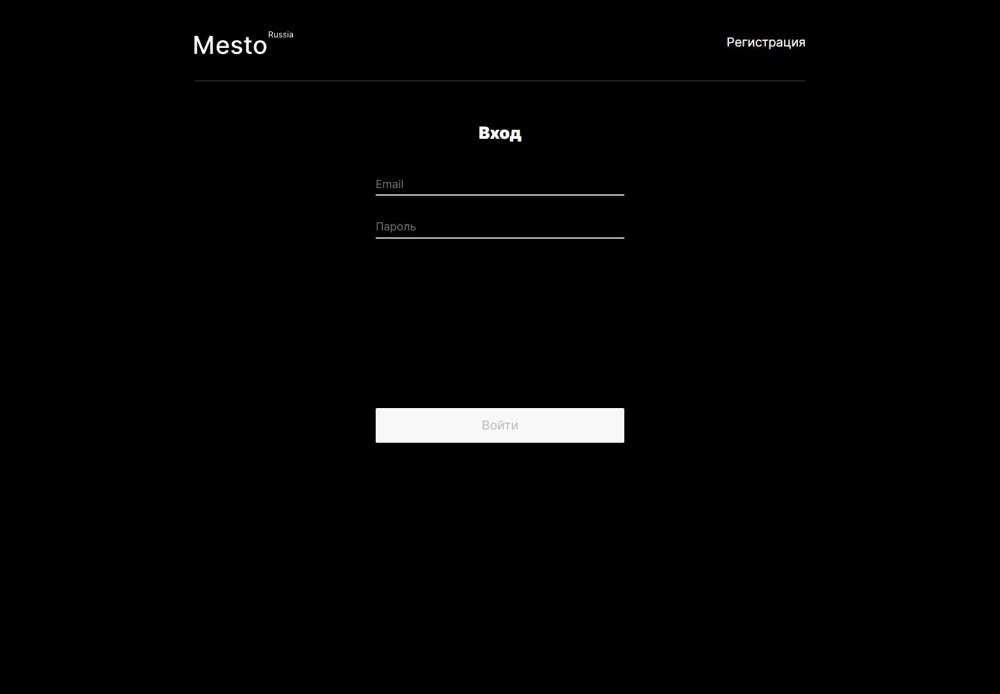
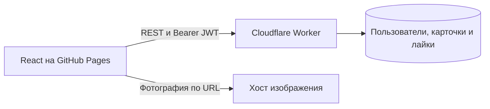

<div align="center">

# 📷 Mesto Full-stack

**Общая фотолента с личными профилями. Пользователи добавляют места по ссылке на фотографию и отмечают понравившиеся карточки.**

  

[Открыть Mesto](https://goldlexx.github.io/react-mesto-api-full/) · [REST API](#rest-api) · [Локальная разработка](#локальная-разработка)

</div>



## От профиля до первой карточки

Зарегистрируйтесь, войдите и заполните профиль. Имя, описание и аватар редактируются в отдельных формах. Для нового места укажите название и HTTP(S)-ссылку на изображение. Файл остаётся у владельца изображения, а Mesto хранит ссылку.

В ленте можно открыть фотографию крупно, поставить или снять лайк. Пользователь может удалить собственную карточку. Сервер проверяет владельца, поэтому право удаления не зависит от того, видна ли кнопка в интерфейсе.

## Архитектура



| Технология | Что делает в проекте |
| --- | --- |
| React 18 и React Router | Формы, защищённые маршруты, состояние профиля и карточек в [frontend/](frontend/) |
| Cloudflare Workers и Web Crypto | REST API, проверка прав, хеширование паролей и подпись JWT в [worker.js](backend/worker.js) |
| D1 | Отдельная база Mesto со [схемой и миграциями](backend/migrations/) |
| Express и MongoDB | Предыдущая реализация в backend для локальной разработки |

## REST API

Опубликованный адрес — `https://mesto-api.rustik-yuldashev.workers.dev`. Регистрация (`POST /signup`) и вход (`POST /signin`) доступны без JWT. Успешный вход возвращает JSON с полем `token`.

| Действие | Маршруты с Bearer JWT |
| --- | --- |
| Читать и редактировать профиль | `GET /users/me`, `PATCH /users/me`, `PATCH /users/me/avatar` |
| Смотреть пользователей | `GET /users`, `GET /users/:id` |
| Работать с лентой | `GET /cards`, `POST /cards`, `DELETE /cards/:cardId` |
| Поставить или снять лайк | `PUT /cards/:cardId/likes`, `DELETE /cards/:cardId/likes` |

Пример чтения ленты в локальном Worker. Подставьте JWT тестовой учётной записи в переменную shell `TOKEN`.

```sh
curl -H "Authorization: Bearer $TOKEN" http://localhost:8787/cards
```

Ответ — массив карточек, для пустой ленты — `[]`. У карточки есть поля `name`, `link`, `owner` и `likes`.

## Локальная разработка

**Клиент.** Из корня репозитория выполните

```sh
cd frontend
npm ci
npm start
```

По умолчанию клиент обращается к опубликованному API. Для собственного экземпляра задайте `REACT_APP_API_BASE_URL` в `frontend/.env.local` до запуска.

**Worker с локальной D1.** В другом терминале из корня перейдите в `backend/`, установите зависимости и создайте `.dev.vars` с отдельным случайным `JWT_SECRET`. Затем выполните

```sh
npx wrangler d1 migrations apply mesto-api-db --local
npm run cf:dev
```

Подробности конфигурации и прежний вариант на Express описаны в [документации backend](backend/README.md).

## Тестирование

В `frontend/` команда `npm test -- --watchAll=false` проверяет обработку HTTP-ответов. `npm run build` собирает клиент. В `backend/` команда `npm test` относится к прежнему Express API. Для интеграционных тестов MongoDB используйте отдельную одноразовую базу с суффиксом `_test` в `MONGODB_TEST_URI`: набор тестов очищает данные.

В манифесте серверной части указана лицензия ISC. [package.json](backend/package.json)
